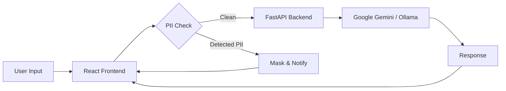

# Ayush Tiwari


## 🌟 Tagline
**Passionate Cybersecurity Engineer & Full‑Stack Developer** – building secure, privacy‑first AI solutions.

---

## 📖 About Me
I am an Integrated M.Tech student in Computer Science (Cybersecurity) at VIT Bhopal with a strong foundation in software engineering, AI‑assisted development, and security research. My work blends modern web technologies with privacy‑preserving AI, and I thrive on leading technical teams and delivering end‑to‑end products.

---

## 🎓 Education
```mermaid
graph TD;
    A[Integrated M.Tech – Computer Science (Cybersecurity) – VIT Bhopal] -->|GPA 8.81/10| B[2024‑2029];
    C[Class 12th – Little Flower Co‑Ed School] -->|Percentage 89%| D[2024];
```
- **Integrated M.Tech in Computer Science (Cybersecurity)** – *VIT Bhopal* (2024‑2029)
  - Current GPA: **8.81 / 10**
- **Class 12th** – *Little Flower Co‑Ed School* (2024)
  - Percentage: **89%**

---

## 🛠️ Skills
### Languages & Frameworks
- **Languages:** Java, Python, C++, JavaScript, SQL, HTML/CSS
- **Frameworks & Tools:** React, Node.js/Express, FastAPI, REST API design, MongoDB, CrewAI, Git/GitHub

### AI‑Assisted Development
- GitHub Copilot, Google Antigravity, Local/Agentic LLM workflows (Ollama + Llama 3.1, Continue)
- Google Gemini API integration, Prompt engineering

### Core CS Fundamentals
- Data Structures & Algorithms, Object‑Oriented Design, Complexity Analysis, Relational Databases

### Security Tools
- Nmap, Wireshark, Kali Linux, Cisco Packet Tracer, MobSF

---

## 💼 Experience
### Cybersecurity Virtual Intern – Deloitte (Forage) *(Remote, 2024)*
- Analyzed IAM and endpoint security exposure protocols to identify vulnerabilities.
- Evaluated technical documentation for security infrastructures, ensuring alignment with industry standards.

### Cyber Risk Virtual Intern – Tata Group (Forage) *(Remote)*
- Conducted cyber‑risk assessments on system architectures, documenting critical entry points.
- Developed secure system design scenarios to mitigate potential threats during early‑stage development.

---

## 🚀 Projects
### Project O3 – Privacy‑First AI Chat Assistant *(2024)*
- **Stack:** FastAPI backend, React frontend, Google Gemini & local Ollama/Llama 3.1 models.
- Implemented a **PII‑detection & masking** layer (regex + BERT‑based token classification) to keep sensitive data client‑side.
- Added a **WebGPU/ONNX Runtime** inference path (Transformers.js) for client‑side classification.
- Utilized GitHub Copilot to debug UI scroll‑position bugs.



### AI Hackathon Slide Evaluator – Agentic Multi‑LLM Jury *(2024)*
- Offline, multi‑stage pipeline scoring hackathon decks using local vision‑language models (Gemma via Ollama) and CrewAI orchestration (Qwen2.5‑Coder).
- Two‑stage map‑reduce: per‑slide visual extraction (PyMuPDF) → rubric scoring with citations → ranking agent produces markdown leaderboard.

### Drishti – Real‑Time Eye Health Monitor *(2024)*
- React web app leveraging **Google MediaPipe FaceMesh** for blink‑rate & screen‑distance tracking (30+ FPS, client‑side).
- Node.js/Express + MongoDB backend stores analytics; rules‑based coaching (e.g., 20‑20‑20 reminders).

---

## 🌐 Leadership & Activities
- **President, Blockchain Club, VIT Bhopal** – orchestrated the SVH 2026 hackathon simulation, handling approvals, rubric design, and registration system.
- **Co‑Lead, Event Management** – led an 11‑member team for technical & non‑technical events, managing end‑to‑end coordination.
- **Academic Mentor & Public Speaker** – tutored 50+ students (Grades 7‑12) in Physics, Maths, Chemistry; hosted university tech fests and Health Tech Club events.

---


---

